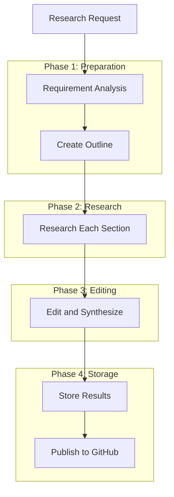

# Deep Research Automation

An automated workflow system for deep research integrated with LLM (Large Language Model). This system automates the entire research process from requirement analysis, outline creation, information gathering and synthesis, to producing high-quality analytical content.

## 📚 Documentation

- **[API Specification (API_SPEC_VI.md)](docs/API_SPEC_VI.md)** - Detailed API endpoints, request/response and sequence diagrams _(for users/integrators, Vietnamese)_
- **[Architecture Overview (ARCHITECTURE_OVERVIEW_VI.md)](docs/ARCHITECTURE_OVERVIEW_VI.md)** - System architecture and developer guide _(for developers, Vietnamese)_

## Key Features

- Analyze research requirements and automatically generate detailed research outlines
- Conduct in-depth research and synthesize results with references
- Create complete content with standard formatting for the final document
- Track progress and cost of using LLM/search APIs for each task
- Optimize data storage and minimize redundancy
- Support storing results on GitHub

## Complete Research Process



## Installation

1. Clone repository:
```bash
git clone https://github.com/yourusername/deep-research-agent.git
cd deep-research-agent
```

2. Install dependencies:
```bash
pip install -r requirements.txt
```

3. Configure environment variables:
Create a `.env` file with the following environment variables:
```
# LLM Services
OPENAI_API_KEY=your_openai_api_key
ANTHROPIC_API_KEY=your_anthropic_api_key

# Search Services
PERPLEXITY_API_KEY=your_perplexity_api_key
GOOGLE_API_KEY=your_google_api_key
GOOGLE_CSE_ID=your_google_cse_id

# Storage Services (optional)
GITHUB_TOKEN=your_github_token
GITHUB_USERNAME=your_github_username
GITHUB_REPO=your_github_repo
```

## Usage

### Run the application:
```bash
uvicorn app.api.main:app --host 0.0.0.0 --port 8000 --reload
```

### Main API Endpoints:

#### 1. Create a complete research request:
```
POST /api/v1/research/complete
```
Body:
```json
{
  "query": "Research topic"
}
```

#### 2. Check status and results:
```
GET /api/v1/research/{research_id}
GET /api/v1/research/{research_id}/status
GET /api/v1/research/{research_id}/progress
GET /api/v1/research/{research_id}/outline
GET /api/v1/research/{research_id}/cost
```

#### 3. Get list of researches:
```
GET /api/v1/research
```

## 📖 Learn More

- **API Details**: See [API_SPEC_VI.md](docs/API_SPEC_VI.md) for information about endpoints
- **System Architecture**: See [ARCHITECTURE_OVERVIEW_VI.md](docs/ARCHITECTURE_OVERVIEW_VI.md) to understand the structure and design

## Docker

### Requirements
- Docker and Docker Compose installed
- Python 3.11.10 (this version is used in Dockerfile)

### Install and Run with Docker
```bash
# Copy .env.example to .env and configure
cp .env.example .env

# Build image
docker compose build

# Run container
docker compose up -d
```

### Check logs
```bash
# View container logs
docker logs deep-research-agent

# View logs and follow continuously
docker logs -f deep-research-agent

# Filter logs to find errors
docker logs deep-research-agent 2>&1 | grep -i error
```

### Test API
```bash
# Send a research request
curl -X POST http://localhost:8000/api/v1/research/complete \
  -H "Content-Type: application/json" \
  -d '{"query": "What is ChatGPT?", "max_budget": 1.0}'

# Check the status of the request (replace {research_id} with actual ID)
curl http://localhost:8000/api/v1/research/{research_id}/status
```

### Troubleshooting
- **Restart container**: If there are changes to the code, rebuild the image and restart the container:
  ```bash
  docker compose down
  docker compose build
  docker compose up -d
  ```

API available at: http://localhost:8000/api/v1

## License

MIT License - see [LICENSE](LICENSE) for details.
