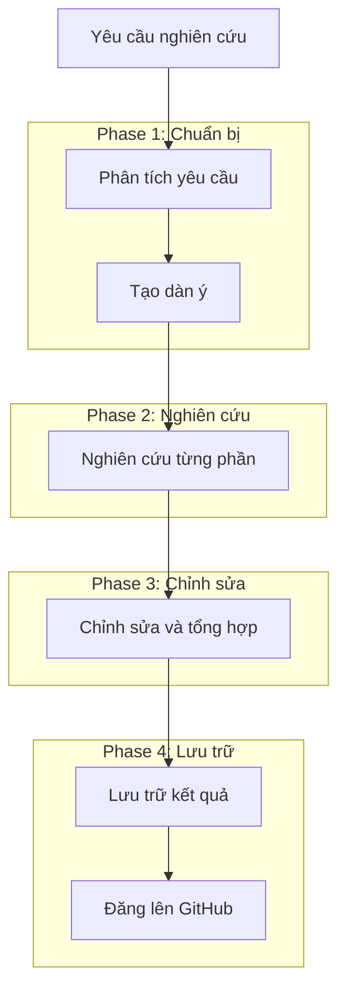

# Deep Research Automation

Hệ thống tự động hóa quy trình nghiên cứu chuyên sâu tích hợp LLM (Large Language Model). Hệ thống này giúp thực hiện toàn bộ quy trình từ phân tích yêu cầu, tạo dàn ý, thu thập và tổng hợp thông tin, đến tạo ra các bài viết phân tích chất lượng cao.

## 📚 Tài liệu

- **[API Specification (API_SPEC_VI.md)](docs/API_SPEC_VI.md)** - Chi tiết về API endpoints, request/response và sequence diagrams _(cho người dùng/integrator)_
- **[Architecture Overview (ARCHITECTURE_OVERVIEW_VI.md)](docs/ARCHITECTURE_OVERVIEW_VI.md)** - Kiến trúc hệ thống và hướng dẫn cho developer _(cho developer)_

## Tính năng chính

- Phân tích yêu cầu nghiên cứu và tự động tạo đề cương nghiên cứu chi tiết
- Tiến hành nghiên cứu chuyên sâu và tổng hợp kết quả có nguồn tham khảo
- Tạo nội dung hoàn chỉnh với định dạng chuẩn cho tài liệu cuối cùng
- Theo dõi tiến độ và chi phí sử dụng LLM/search API cho từng task
- Tối ưu hóa lưu trữ dữ liệu và giảm thiểu dư thừa
- Hỗ trợ lưu trữ kết quả trên GitHub

## Quy trình nghiên cứu hoàn chỉnh



## Cài đặt

1. Clone repository:
```bash
git clone https://github.com/yourusername/deep-research-agent.git
cd deep-research-agent
```

2. Cài đặt dependencies:
```bash
pip install -r requirements.txt
```

3. Cấu hình environment variables:
Tạo file `.env` với các biến môi trường sau:
```
# LLM Services
OPENAI_API_KEY=your_openai_api_key
ANTHROPIC_API_KEY=your_anthropic_api_key

# Search Services
PERPLEXITY_API_KEY=your_perplexity_api_key
GOOGLE_API_KEY=your_google_api_key
GOOGLE_CSE_ID=your_google_cse_id

# Storage Services (tùy chọn)
GITHUB_TOKEN=your_github_token
GITHUB_USERNAME=your_github_username
GITHUB_REPO=your_github_repo
```

## Sử dụng

### Chạy ứng dụng:
```bash
uvicorn app.api.main:app --host 0.0.0.0 --port 8000 --reload
```

### API Endpoints chính:

#### 1. Tạo yêu cầu nghiên cứu hoàn chỉnh:
```
POST /api/v1/research/complete
```
Body:
```json
{
  "query": "Chủ đề cần nghiên cứu"
}
```

#### 2. Kiểm tra trạng thái và kết quả:
```
GET /api/v1/research/{research_id}
GET /api/v1/research/{research_id}/status
GET /api/v1/research/{research_id}/progress
GET /api/v1/research/{research_id}/outline
GET /api/v1/research/{research_id}/cost
```

#### 3. Lấy danh sách các nghiên cứu:
```
GET /api/v1/research
```

## 📖 Tìm hiểu thêm

- **Chi tiết về API**: Xem [API_SPEC_VI.md](docs/API_SPEC_VI.md) để biết thông tin về các endpoints
- **Kiến trúc hệ thống**: Xem [ARCHITECTURE_OVERVIEW_VI.md](docs/ARCHITECTURE_OVERVIEW_VI.md) để hiểu cấu trúc và thiết kế hệ thống

## Docker

### Yêu cầu
- Docker và Docker Compose đã được cài đặt
- Python 3.11.10 (phiên bản này được sử dụng trong Dockerfile)

### Cài đặt và chạy với Docker
```bash
# Sao chép file .env.example thành .env và cấu hình
cp .env.example .env

# Xây dựng image
docker compose build

# Chạy container
docker compose up -d
```

### Kiểm tra logs
```bash
# Xem logs của container
docker logs deep-research-agent

# Xem logs và theo dõi liên tục
docker logs -f deep-research-agent

# Lọc logs để tìm lỗi
docker logs deep-research-agent 2>&1 | grep -i error
```

### Test API
```bash
# Gửi yêu cầu nghiên cứu
curl -X POST http://localhost:8000/api/v1/research/complete \
  -H "Content-Type: application/json" \
  -d '{"query": "Tìm hiểu về ChatGPT là gì?", "max_budget": 1.0}'

# Kiểm tra trạng thái của yêu cầu (thay {research_id} bằng ID thực tế)
curl http://localhost:8000/api/v1/research/{research_id}/status
```

### Xử lý sự cố
- **Khởi động lại container**: Nếu có thay đổi trong code, hãy build lại image và khởi động lại container:
  ```bash
  docker compose down
  docker compose build
  docker compose up -d
  ```

API có sẵn tại: http://localhost:8000/api/v1

## License

MIT License - xem [LICENSE](LICENSE) để biết thêm chi tiết. 