# Deep Research Automation - Architecture Overview

> **Tài liệu dành cho Developer**

Tài liệu này mô tả chi tiết về kiến trúc hệ thống, design patterns, và cấu trúc code của Deep Research Automation.

> **Dành cho người dùng**: Xem [API_SPEC_VI.md](API_SPEC_VI.md) để biết thông tin về các API endpoints và cách sử dụng.

## 📋 Mục lục

- [Tổng quan](#-tổng-quan)
- [Technology Stack](#-technology-stack)
- [Kiến trúc 4 tầng](#-kiến-trúc-4-tầng)
- [Research Workflow](#-research-workflow)
- [Design Patterns](#-design-patterns)
- [Service Dependencies](#-service-dependencies)
- [Data Models](#-data-models)
- [Cấu trúc thư mục](#-cấu-trúc-thư-mục)

---

## 🎯 Tổng quan

Deep Research Automation là một hệ thống tự động hóa quy trình nghiên cứu chuyên sâu tích hợp LLM (Large Language Model). Hệ thống được xây dựng theo kiến trúc modular với các design patterns rõ ràng, sử dụng workflow automation để điều phối các bước nghiên cứu từ phân tích yêu cầu, thu thập thông tin, đến tạo nội dung phân tích hoàn chỉnh.

### Quy trình nghiên cứu hoàn chỉnh

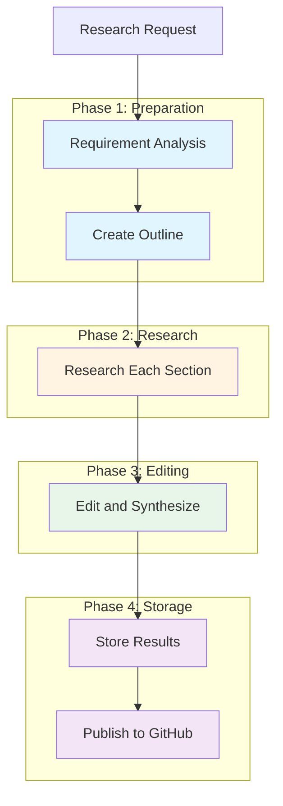

---

## 💻 Technology Stack

| Component | Technology | Mô tả |
|-----------|-----------|-------|
| **Language** | Python 3.11.10 | Core language |
| **Web Framework** | FastAPI | Async API framework |
| **LLM Providers** | OpenAI, Anthropic Claude | AI models |
| **Search Services** | Perplexity, Google CSE | Information retrieval |
| **Storage** | File System, GitHub | Data persistence |
| **Validation** | Pydantic | Data validation |
| **Container** | Docker | Deployment |

---

## 🏗️ Kiến trúc 4 tầng

### Tổng quan kiến trúc

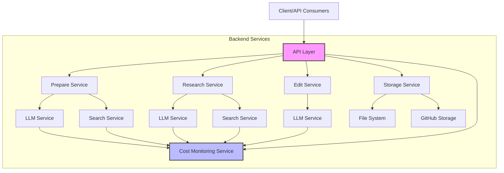

### 1. API Layer (`app/api/`)

**Vai trò**: Điểm tiếp xúc với client, xử lý HTTP requests/responses

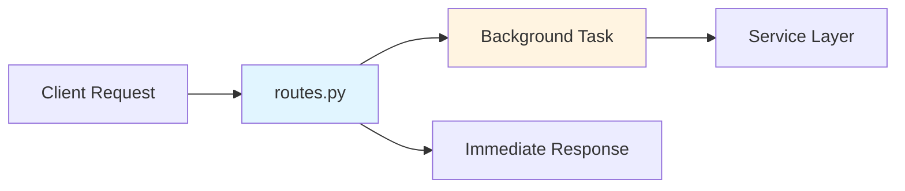

**Files chính**:
- [`main.py`](../app/api/main.py) - FastAPI application setup, CORS config
- [`routes.py`](../app/api/routes.py) - 16 API endpoints

**Endpoints**: Xem chi tiết tại [API_SPEC_VI.md](API_SPEC_VI.md)

### 2. Core Services Layer (`app/services/core/`)

**Vai trò**: Cung cấp các services cơ bản có thể tái sử dụng

#### LLM Services (`app/services/core/llm/`)

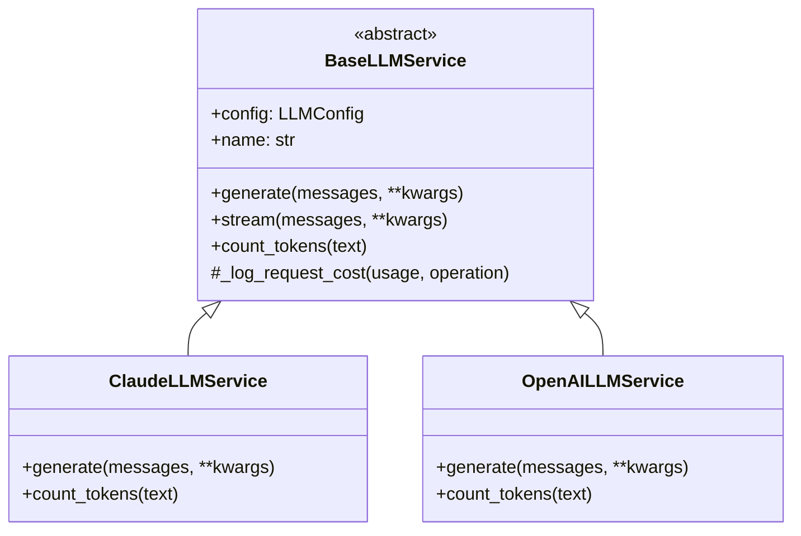

**Files**:
- [`base.py`](../app/services/core/llm/base.py) - Abstract base class
- [`claude.py`](../app/services/core/llm/claude.py) - Anthropic Claude implementation
- [`openai.py`](../app/services/core/llm/openai.py) - OpenAI GPT implementation

#### Search Services (`app/services/core/search/`)

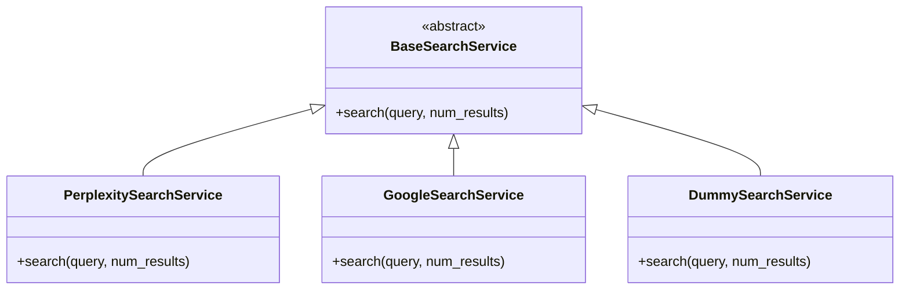

#### Storage Services (`app/services/core/storage/`)

**Implementations**:
- `FileStorageService` - Local filesystem storage
- `GitHubStorageService` - GitHub repository integration

#### Monitoring (`app/services/core/monitoring/`)

**CostMonitoringService**:
- Tracking LLM API costs
- Tracking search API costs
- Budget management
- Usage statistics

### 3. Research Services Layer (`app/services/research/`)

**Vai trò**: Xử lý business logic cho quy trình nghiên cứu

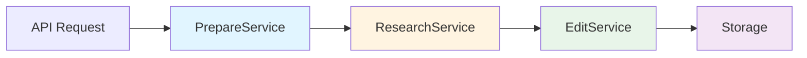

#### PrepareService (`prepare.py`)

**Phase 1: Preparation**

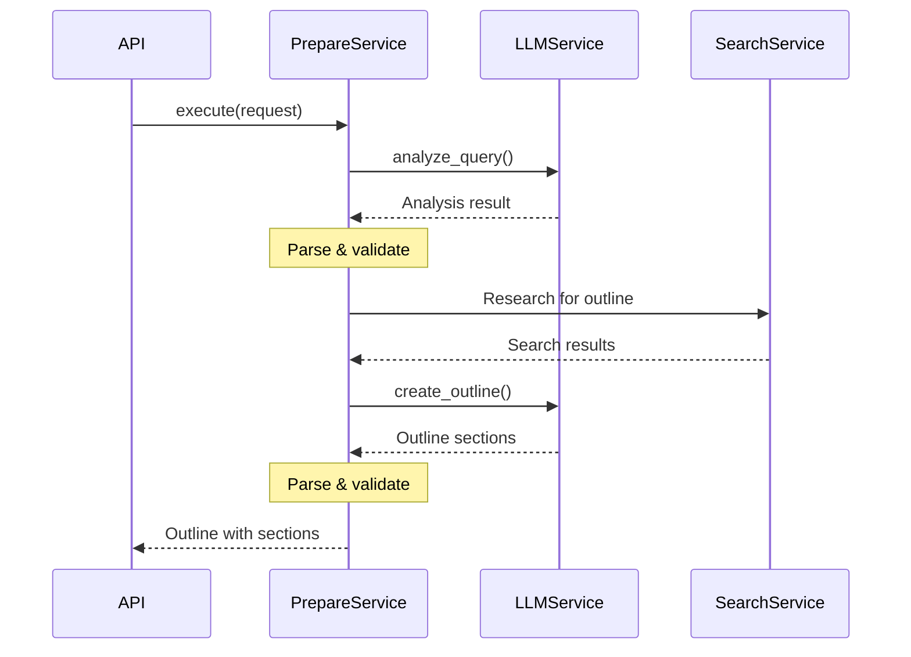

**Methods**:
- `execute()` - Điều phối toàn bộ phase 1
- `analyze_query()` - Phân tích yêu cầu nghiên cứu
- `create_outline()` - Tạo outline chi tiết
- `_validate_analysis_relevance()` - Kiểm tra tính liên quan
- `_manual_parse_analysis()` - Parse kết quả
- `_validate_outline_relevance()` - Validate outline
- `_manual_parse_outline()` - Parse outline structure

#### ResearchService (`research.py`)

**Phase 2: Research**

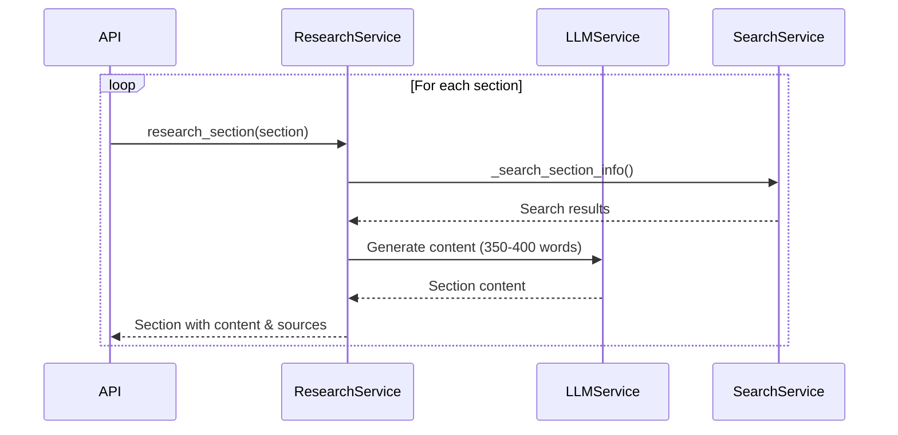

**Methods**:
- `execute()` - Điều phối research process
- `research_section()` - Research từng section
- `_search_section_info()` - Tìm kiếm thông tin

#### EditService (`edit.py`)

**Phase 3: Editing**

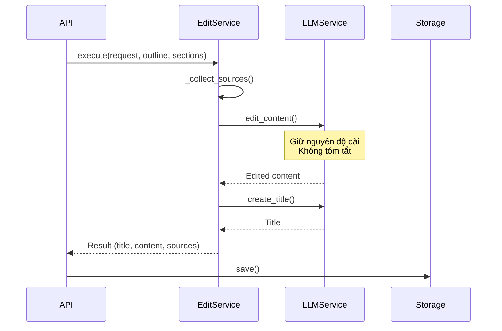

**Methods**:
- `execute()` - Điều phối editing process
- `edit_content()` - Chỉnh sửa và tổng hợp
- `create_title()` - Tạo tiêu đề
- `_collect_sources()` - Thu thập sources

### 4. Model Layer (`app/models/`)

**Vai trò**: Định nghĩa data structures và validation

#### Research Models (`research.py`)

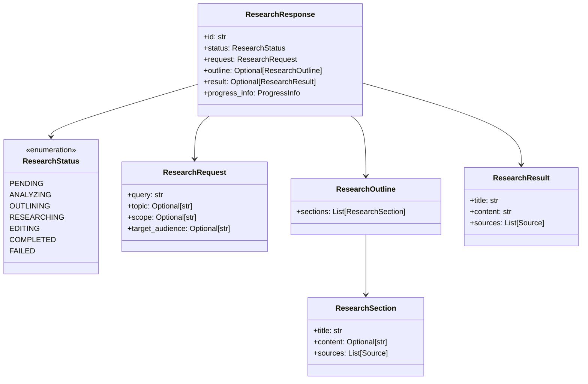

---

## 🔄 Research Workflow

### Complete Flow với Background Task

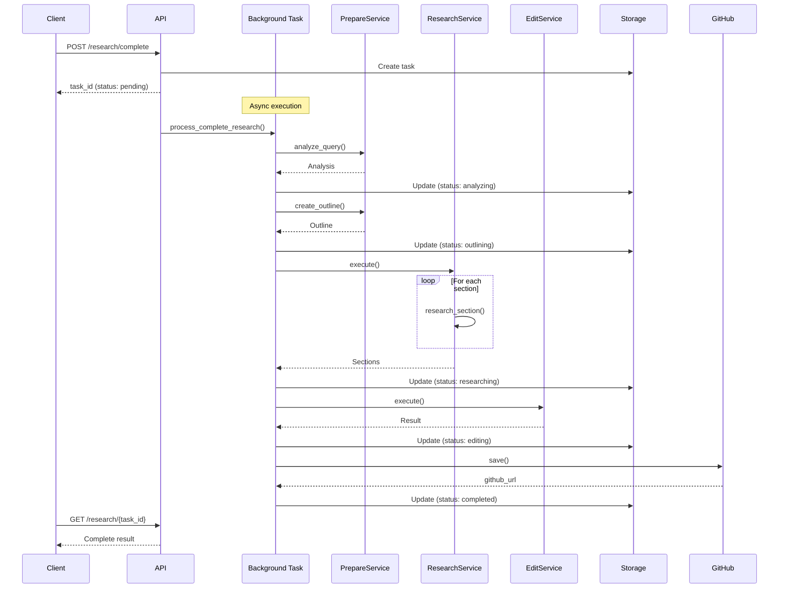

### Status Transitions

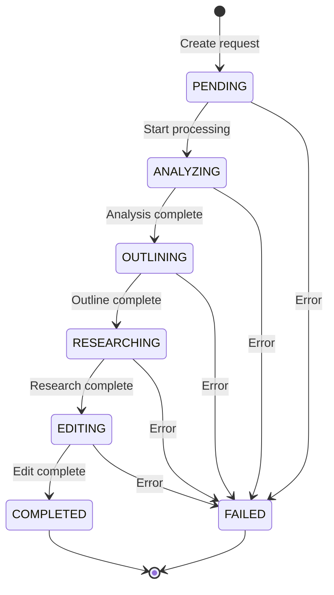

---

## 🎨 Design Patterns

### 1. Factory Pattern

**ServiceFactory** - Quản lý việc tạo và cache services

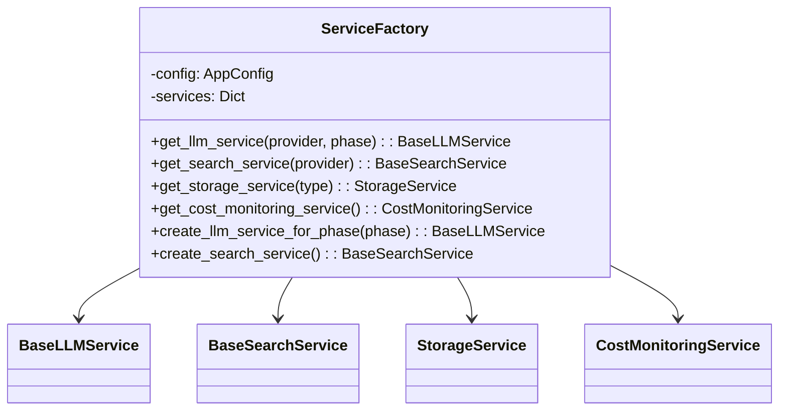

**Location**: [`app/core/factory.py`](../app/core/factory.py:22)

**Usage**:
```python
from app.core.factory import get_service_factory

factory = get_service_factory()
llm_service = factory.get_llm_service("openai", "prepare")
search_service = factory.get_search_service("perplexity")
```

### 2. Strategy Pattern

Pluggable implementations cho LLM, Search, và Storage:

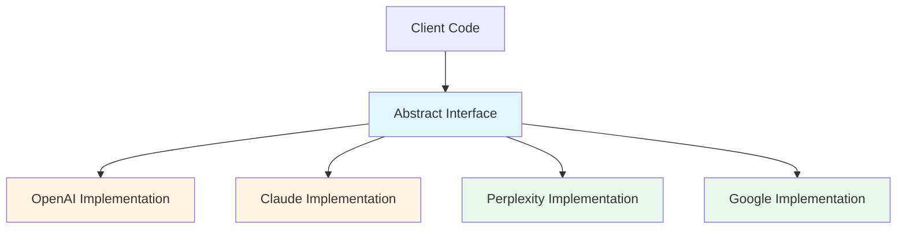

### 3. Template Method Pattern

Base classes định nghĩa workflow chung:

```python
class BaseLLMService(ABC):
    """Template for all LLM services"""

    @abstractmethod
    def get_completion(self, messages, **kwargs):
        """Subclass must implement"""
        pass

    async def generate(self, messages, **kwargs):
        """Template method with common logic"""
        # Pre-processing
        result = await self.get_completion(messages, **kwargs)
        # Post-processing & logging
        self._log_request_cost(usage, operation)
        return result
```

### 4. Singleton Pattern

ServiceFactory duy trì một instance duy nhất:

```python
_service_factory: Optional[ServiceFactory] = None

def get_service_factory() -> ServiceFactory:
    """Get or create singleton instance"""
    global _service_factory
    if _service_factory is None:
        _service_factory = ServiceFactory(settings)
    return _service_factory
```

### 5. Dependency Injection

Services được inject qua constructor:

```python
class PrepareService:
    def __init__(
        self,
        llm_service: BaseLLMService,
        search_service: BaseSearchService,
        cost_service: CostMonitoringService,
    ):
        self.llm_service = llm_service
        self.search_service = search_service
        self.cost_service = cost_service
```

---

## 📦 Service Dependencies

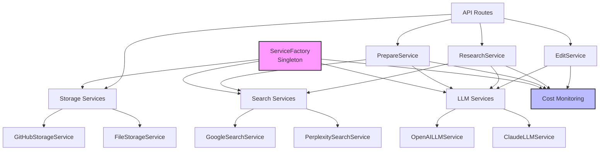

---

## 📊 Data Models

### Research Status Flow

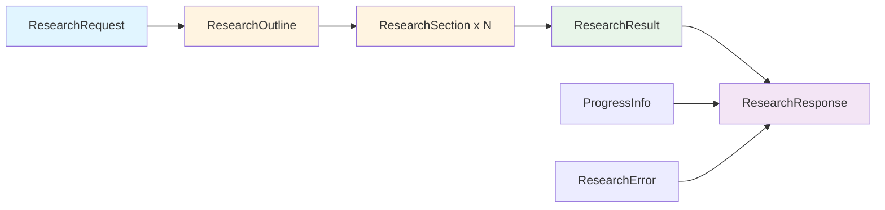

### Key Models

| Model | File | Mô tả |
|-------|------|-------|
| `ResearchStatus` | [`research.py:5`](../app/models/research.py:5) | Enum các trạng thái |
| `ResearchRequest` | [`research.py`](../app/models/research.py) | Input request |
| `ResearchSection` | [`research.py`](../app/models/research.py) | Section data |
| `ResearchOutline` | [`research.py`](../app/models/research.py) | Outline structure |
| `ResearchResult` | [`research.py`](../app/models/research.py) | Final result |
| `ResearchResponse` | [`research.py`](../app/models/research.py) | API response |
| `ProgressInfo` | [`research.py`](../app/models/research.py) | Progress tracking |

---

## 📁 Cấu trúc thư mục

```
deep-research-agent-python/
│
├── app/                           # Application source code
│   ├── __init__.py
│   │
│   ├── api/                       # API Layer
│   │   ├── __init__.py
│   │   ├── main.py                # FastAPI app, CORS, startup
│   │   └── routes.py              # 16 API endpoints
│   │
│   ├── core/                      # Core utilities
│   │   ├── __init__.py
│   │   ├── config.py              # App configuration
│   │   ├── factory.py             # ServiceFactory (Singleton)
│   │   ├── logging.py             # Logging setup
│   │   └── exceptions.py          # Custom exceptions
│   │
│   ├── models/                    # Data models (Pydantic)
│   │   ├── __init__.py
│   │   ├── research.py            # Research models
│   │   └── cost.py                # Cost tracking models
│   │
│   ├── services/                  # Business logic
│   │   ├── __init__.py
│   │   │
│   │   ├── core/                  # Core reusable services
│   │   │   ├── __init__.py
│   │   │   │
│   │   │   ├── llm/               # LLM integrations
│   │   │   │   ├── __init__.py
│   │   │   │   ├── base.py        # BaseLLMService (abstract)
│   │   │   │   ├── claude.py      # Claude implementation
│   │   │   │   └── openai.py      # OpenAI implementation
│   │   │   │
│   │   │   ├── search/            # Search services
│   │   │   │   ├── __init__.py
│   │   │   │   ├── base.py        # BaseSearchService
│   │   │   │   ├── perplexity.py  # Perplexity implementation
│   │   │   │   ├── google.py      # Google CSE implementation
│   │   │   │   └── dummy.py       # Testing stub
│   │   │   │
│   │   │   ├── storage/           # Data persistence
│   │   │   │   ├── __init__.py
│   │   │   │   ├── base.py        # Base storage
│   │   │   │   ├── file.py        # Filesystem storage
│   │   │   │   └── github.py      # GitHub integration
│   │   │   │
│   │   │   └── monitoring/        # Cost tracking
│   │   │       ├── __init__.py
│   │   │       ├── cost.py        # CostMonitoringService
│   │   │       └── custom_pricing.py
│   │   │
│   │   └── research/              # Research workflow
│   │       ├── __init__.py
│   │       ├── base.py            # Base research service
│   │       ├── prepare.py         # Phase 1: Prepare
│   │       ├── research.py        # Phase 2: Research
│   │       ├── edit.py            # Phase 3: Edit
│   │       └── storage.py         # Research storage
│   │
│   ├── config/                    # Configuration
│   │   ├── __init__.py
│   │   └── settings.py            # Settings management
│   │
│   └── utils/                     # Utilities
│       ├── __init__.py
│       └── helpers.py
│
├── docs/                          # Documentation
│   ├── API_SPEC_VI.md             # API specification (cho user)
│   └── ARCHITECTURE_OVERVIEW_VI.md # Architecture (cho developer)
│
├── tests/                         # Test suites
│   ├── test_research.py
│   ├── test_research_complete.py
│   └── ...
│
├── data/                          # Research data storage
├── logs/                          # Application logs
├── test_data/                     # Test fixtures
├── test_outputs/                  # Test results
│
├── .env                           # Environment variables (gitignored)
├── .env.example                   # Env template
├── .gitignore
├── .dockerignore
├── Dockerfile                     # Container definition
├── docker-compose.yml             # Docker orchestration
├── requirements.txt               # Python dependencies
├── pytest.ini                     # Pytest configuration
├── LICENSE                        # MIT License
├── README.md                      # English README
├── README_VI.md                   # Vietnamese README
└── run.py                         # Development entry point
```

---

## 🔑 Key Files Reference

| File Path | Mô tả | Vai trò |
|-----------|-------|---------|
| [`app/api/main.py`](../app/api/main.py) | FastAPI app | Entry point |
| [`app/api/routes.py`](../app/api/routes.py) | API endpoints | Request handling |
| [`app/core/factory.py`](../app/core/factory.py:22) | Service factory | Dependency management |
| [`app/services/research/prepare.py`](../app/services/research/prepare.py) | Prepare service | Phase 1 logic |
| [`app/services/research/research.py`](../app/services/research/research.py) | Research service | Phase 2 logic |
| [`app/services/research/edit.py`](../app/services/research/edit.py) | Edit service | Phase 3 logic |
| [`app/models/research.py`](../app/models/research.py) | Data models | Type definitions |
| [`app/services/core/llm/base.py`](../app/services/core/llm/base.py) | LLM base | Abstract interface |

---

## 🌟 Best Practices

### 1. Adding a New LLM Provider

```python
# 1. Create implementation in app/services/core/llm/
class NewLLMService(BaseLLMService):
    async def get_completion(self, messages, **kwargs):
        # Implementation
        pass

    def count_tokens(self, text: str) -> int:
        # Implementation
        pass

# 2. Register in ServiceFactory.get_llm_service()
def get_llm_service(self, provider: str):
    if provider == "new_provider":
        return NewLLMService(config)
    # ...

# 3. Add pricing in app/services/core/monitoring/custom_pricing.py
MODEL_PRICING = {
    "new_provider": {
        "model-name": {"input": 0.001, "output": 0.002}
    }
}
```

### 2. Adding a New Endpoint

```python
# In app/api/routes.py
@router.get("/research/{research_id}/new_endpoint")
async def get_new_info(research_id: str):
    """
    New endpoint description.

    See API_SPEC_VI.md for details.
    """
    task = research_storage_service.get_task(research_id)
    # Process...
    return response
```

### 3. Error Handling

```python
from app.core.exceptions import ResearchError

try:
    result = await service.execute()
except ResearchError as e:
    logger.error(f"Research failed: {e}")
    raise HTTPException(status_code=500, detail=str(e))
```

---

## 📚 Xem thêm

- **API Endpoints**: Chi tiết về các endpoints tại [API_SPEC_VI.md](API_SPEC_VI.md)
- **User Guide**: Hướng dẫn sử dụng tại [README_VI.md](../README_VI.md)
- **English Docs**: [README.md](../README.md), [api.md](api.md)

---

## 🤝 Contributing

Khi contribute code:

1. Follow existing patterns và conventions
2. Update documentation khi thay đổi architecture
3. Add tests cho new features
4. Keep services decoupled và testable
5. Use dependency injection
6. Document public APIs

---

**Last Updated**: 2025-11-06
**Maintainer**: Development Team
